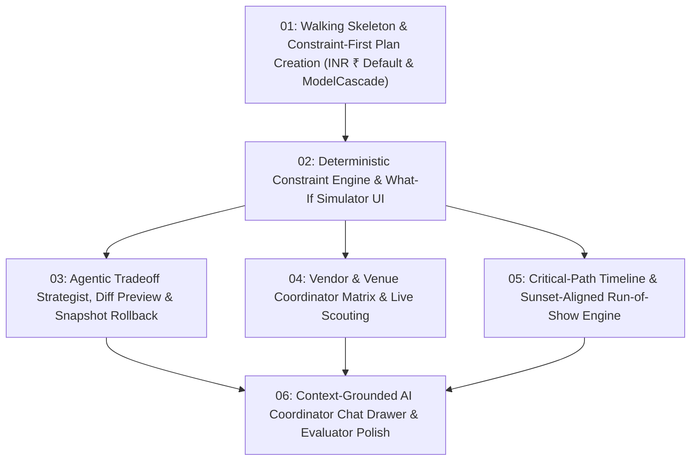

# PartyPlanner — Tracer-Bullet Ticket Breakdown

All local ticket files are published under `.scratch/party-planner/issues/` in dependency order.

## Dependency Graph

## Tickets

1. **[01: Walking Skeleton & Constraint-First Plan Creation](../.scratch/party-planner/issues/01-walking-skeleton-and-plan-creation.md)**
   * **Blocked by**: None (can start immediately)
   * **Status**: `completed`
2. **[02: Deterministic Constraint Engine & What-If Simulator UI](../.scratch/party-planner/issues/02-deterministic-constraint-engine-and-what-if-ui.md)**
   * **Blocked by**: `01`
   * **Status**: `completed`
3. **[03: Agentic Tradeoff Strategist, Diff Preview & Snapshot Rollback](../.scratch/party-planner/issues/03-agentic-tradeoff-strategist-and-snapshots.md)**
   * **Blocked by**: `02`
   * **Status**: `completed`
4. **[04: Vendor & Venue Coordinator Matrix & Live Scouting](../.scratch/party-planner/issues/04-vendor-and-venue-coordinator-matrix.md)**
   * **Blocked by**: `02`
   * **Status**: `completed`
5. **[05: Critical-Path Timeline & Sunset-Aligned Run-of-Show Engine](../.scratch/party-planner/issues/05-critical-path-timeline-and-run-of-show.md)**
   * **Blocked by**: `02`
   * **Status**: `completed`
6. **[06: Context-Grounded AI Coordinator Chat Drawer & Evaluator Polish](../.scratch/party-planner/issues/06-grounded-coordinator-chat-and-evaluator-polish.md)**
   * **Blocked by**: `03`, `04`, `05`
   * **Status**: `completed`
